# SoloForce

> 🌐 **语言 / Language**: [English](./README.md) | [中文](./README-zh.md)

<p align="center">
  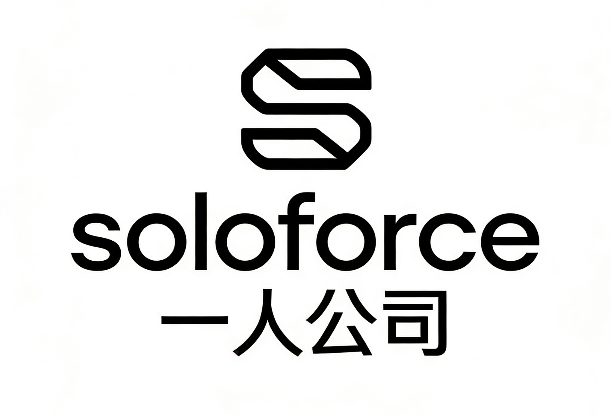
</p>

<p align="center">
  <strong>让一个人成就一家公司 · 数字孪生 × AI 协同 × 赛博养员工</strong>
</p>

<p align="center">
  <a href="https://github.com/yourusername/SoloForce">
    
  </a>
  <a href="https://github.com/yourusername/SoloForce/blob/main/LICENSE">
    
  </a>
  <a href="https://github.com/yourusername/SoloForce">
    
  </a>
  <a href="https://github.com/yourusername/SoloForce">
    
  </a>
  <a href="https://github.com/yourusername/SoloForce">
    
  </a>
</p>

---

## 🆕 v2.0 更新说明（2026年4月）

> 本次更新新增三大核心功能：
> 1. 🏢 **数字孪生公司地图** — 6层3D楼层，可单层浏览或平铺总览
> 2. 💬 **AI 会议室** — 多角色协商讨论 + 共享黑板
> 3. 🏭 **多行业模板扩展** — 8大行业，28+职业类型
该版本仍在改进中，可能存在很多问题。

---

## 📋 目录

- [项目介绍](#-项目介绍)
- [项目预览](#-项目预览)
- [核心特性](#-核心特性)
- [技术栈](#-技术栈)
- [快速开始](#-快速开始)
- [项目结构](#-项目结构)
- [配置说明](#-配置说明)
- [使用指南](#-使用指南)
- [未来规划](#-未来规划)
- [许可证](#-许可证)

---

## 📖 项目介绍

**SoloForce（一人公司）** 是一款 AI 驱动的数字孪生工作流编排系统——用数字员工组建你的虚拟公司，在赛博空间里运营一家真正运转的企业。

### 🌟 核心理念

> **未来的企业将不再依赖传统的"人力资源"，而是转向"数字人力资源"**
>
> 一个人类 CEO + N 个 AI 数字员工 = 一个高效运转的"一人公司"

---

## 📸 项目预览

### 🏢 公司地图 — 数字孪生楼层

| | |
|:---:|:---:|
| 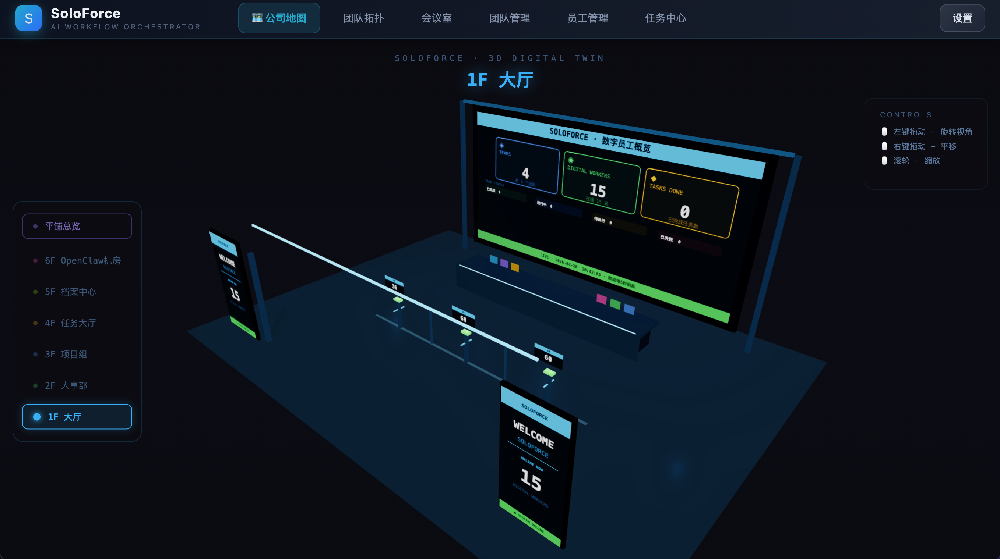 | 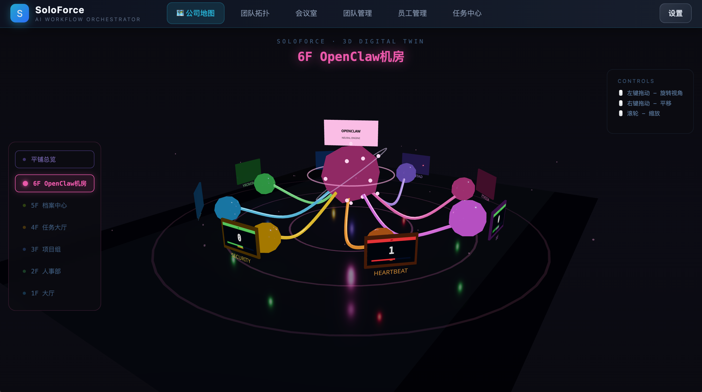 |
| **1F 大厅** — 迎宾入口与员工工位 | **6F OpenClaw 机房** — 神经网络核心 |
| 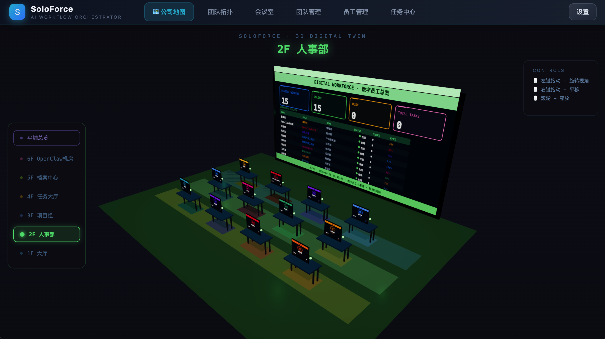 | 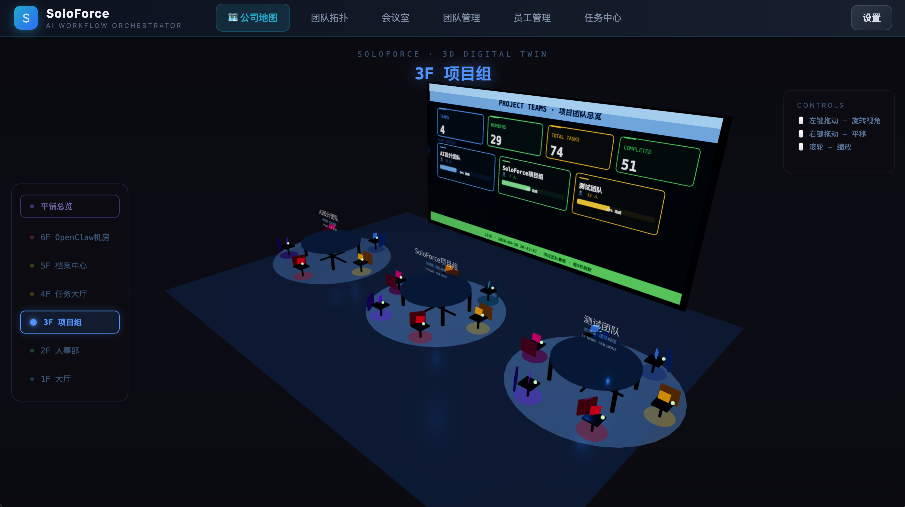 |
| **2F 人事部** — 员工档案管理 | **3F 项目组** — 多项目看板 |
| 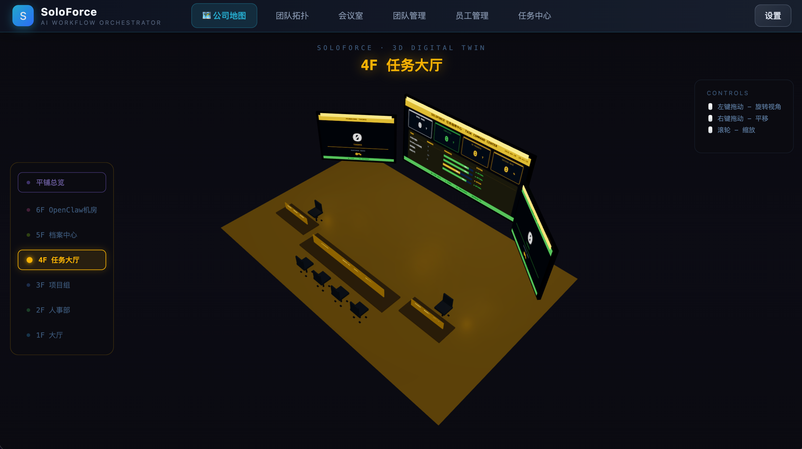 | 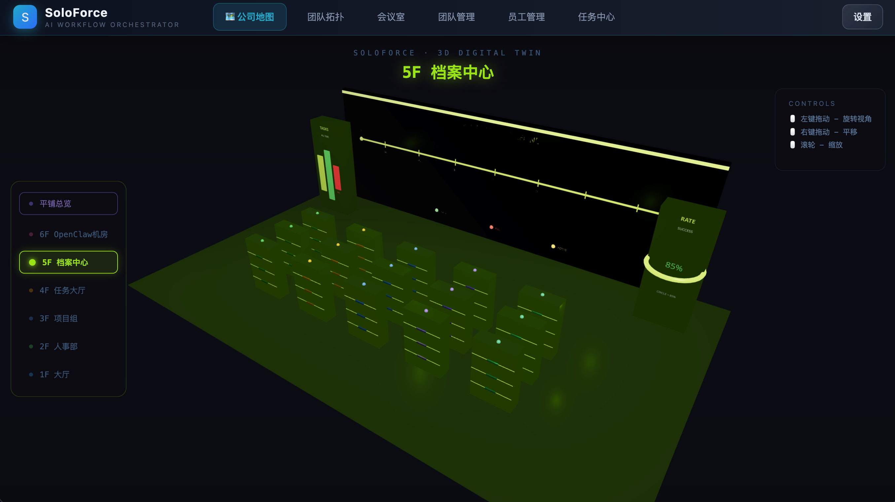 |
| **4F 任务大厅** — 环形指挥台 | **5F 档案中心** — 文件柜阵列 |

### 🗺️ 平铺总览

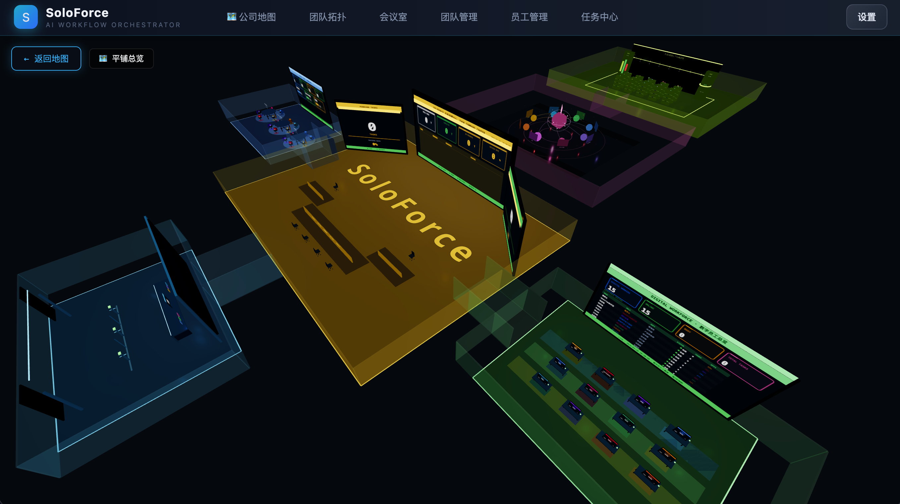

所有楼层从下而上排列展示，一屏纵览整栋数字大楼。

### 💬 会议室 — AI 协商讨论

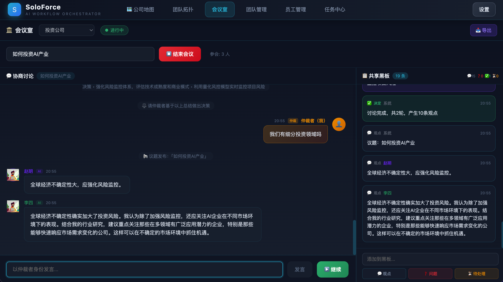

多角色 AI 协商讨论，仲裁者（用户）可随时插话打断。

### 团队拓扑

| | |
|:---:|:---:|
| 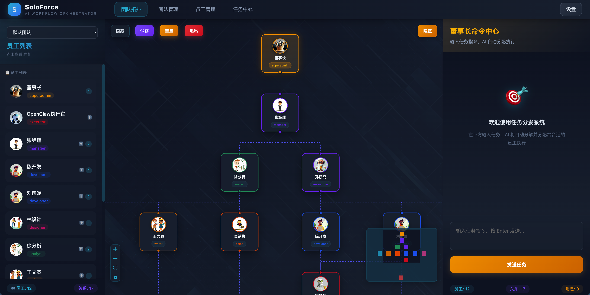 | 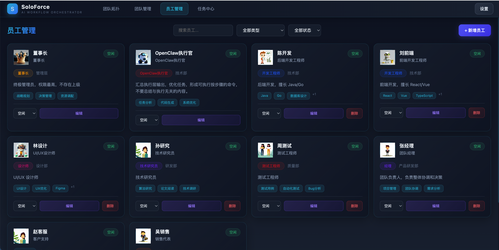 |
| **团队拓扑** | **员工管理** |
| 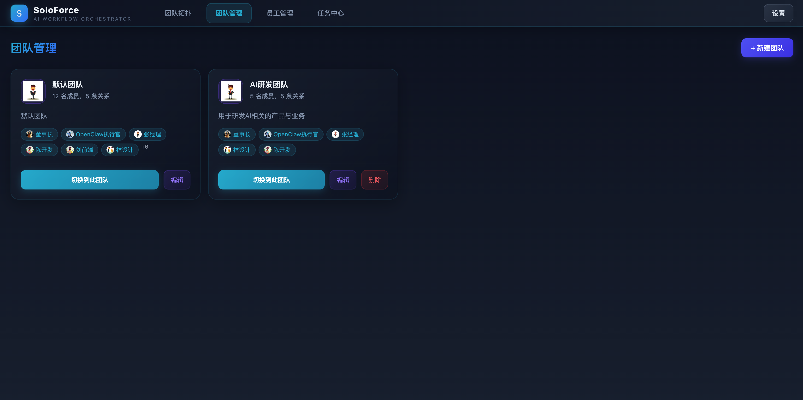 | 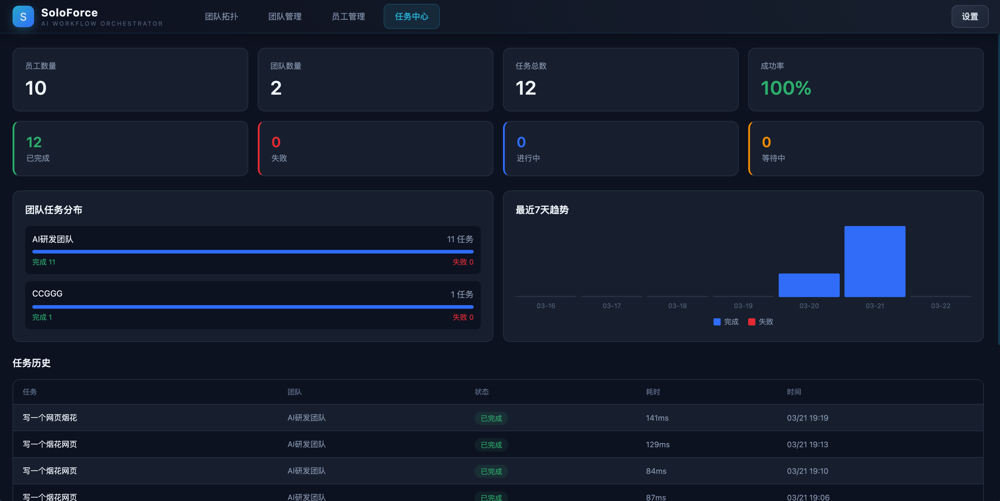 |
| **团队管理** | **任务中心** |

---

## ✨ 核心特性

### 🏢 1️⃣ 公司地图（数字孪生楼层）🆕

数字孪生的 6 层办公楼，每层有独特主题色和 3D 场景，支持两种浏览模式：

- **单层3D视图** — 点击顶部楼层按钮，聚焦单层 3D 可视化，相机自动环绕
- **平铺总览** — 所有楼层从下而上排列展示，一屏纵览整栋数字大楼

可以实现公司组织结构、员工关系、任务分配和任务执行流程的各类数据的完整可视化。

---

### 💬 2️⃣ 会议室（AI 协商讨论）🆕

多角色 AI 协商讨论空间，模拟真实会议场景：

- **AI 角色队列发言** — 多个 AI 角色按顺序发言讨论，用户（仲裁者）可随时插话打断
- **共享黑板** — 会议过程中可添加问题要点，实时同步显示
- **可配置系统提示词** — 自定义 AI 角色性格、发言风格和讨论规则
- **协商引擎驱动** — AI 自主判断发言时机，维持讨论节奏

---

### 👥 3️⃣ 团队拓扑可视化

图形化展示"数字员工"组织和隶属关系，支持拖拽连线建立管理流程。

---

### 🏭 4️⃣ 多行业模板扩展 🆕

支持创建不同行业的公司，配置专属的职业角色：

| 行业 | 代表职业角色 |
|------|------------|
| 科技 / 互联网 | 前端、后端、架构师、测试、产品、运营 |
| 金融 / 证券 | 证券分析师、基金经理、风控专员、量化研究员 |
| 医疗健康 | 医学编辑、健康顾问、数据分析师、BD经理 |
| 教育培训 | 课程顾问、教研员、学科教师、留学顾问 |
| 媒体 / 创意 | 内容主编、新媒体运营、剪辑师、商务BD |
| 制造业 | 工艺工程师、质量管理、供应链管理、设备维护 |
| 企业通用 | 行政、法务、财务、人力资源 |
| 自定义 | 自由定义行业和职业 |

**标准职业（12种）**：董事长、执行官、经理、开发、设计、数据分析、文案、客服、研究、测试、销售、自定义角色。

---

### 🤖 5️⃣ 自定义数字员工

创建和管理专属的数字员工，定义角色、技能和职责，打造你的虚拟团队。

---

### ⚡ 6️⃣ AI 智能任务分发

输入任务后，AI 自动分析并分发给合适的"数字员工"，模拟真实公司的任务分配流程。

---

### 🚀 7️⃣ OpenClaw 执行集成

任务执行完成后，提取可执行的技术命令，一键发送到 OpenClaw 执行。

---

### 📋 8️⃣ 多团队管理

支持创建多个虚拟团队，每个团队有独立的员工配置、拓扑关系和行业属性。

---

## 🛠️ 技术栈

| 类别 | 技术 |
|------|------|
| 前端 | React 18 + TypeScript + Vite |
| 3D 可视化 | Three.js + @react-three/fiber + @react-three/drei |
| 拓扑图 | React Flow（拖拽连线） |
| 后端 | Express + Node.js + 硅基流动 API |
| AI 执行 | OpenClaw Gateway + 硅基流动大模型 |

---

## 🚀 快速开始

### 安装

```bash
git clone https://github.com/yourusername/SoloForce.git
cd SoloForce
npm install
```

### 配置

```bash
cp .env.example .env
# 编辑 .env，填入硅基流动 API Key
```

### 启动

```bash
# 同时启动前端 + 后端
npm run dev:all

# 或分别启动：
npm run server   # 后端 5301
npm run dev      # 前端 5300
```

访问 **http://localhost:5300**

### 构建

```bash
npm run build
```

---

## 📁 项目结构

```
SoloForce/
├── public/
│   └── avatars/           # 数字员工头像
├── docs/
│   └── images/           # 📸 项目截图
├── src/
│   ├── control-room/     # 🏢 数字孪生楼层系统（6层3D）
│   │   ├── Floor3DDemo.tsx # 3D 楼层主场景
│   │   └── floorConfigs.ts  # 楼层配置
│   ├── components/
│   │   ├── EmployeeNode.tsx # 拓扑图节点
│   │   ├── ChatPanel.tsx   # 右侧对话面板
│   │   └── Sidebar.tsx     # 侧边栏
│   ├── pages/
│   │   ├── TeamTopology.tsx  # 团队拓扑图
│   │   ├── TeamManagement.tsx # 团队管理
│   │   ├── MeetingRoom.tsx   # 💬 会议室（协商讨论）
│   │   └── TaskCenter.tsx    # 任务中心
│   └── store.ts            # Zustand 状态管理
├── server.ts                # Express 后端（含 OpenClaw 集成）
└── package.json
```

---

## 🔧 配置说明

### 环境变量

```env
PORT=5301

# 硅基流动大模型 API（必需）
OPENAI_BASE_URL=https://api.siliconflow.cn/v1
OPENAI_MODEL=Qwen2.5-7B-Instruct
OPENAI_API_KEY=your_siliconflow_key

# OpenClaw（可选，用于会议室 AI 角色发言）
OPENCLAW_URL=http://127.0.0.1:18789
OPENCLAW_TOKEN=your_openclaw_token
```

### 端口说明

| 服务 | 端口 | 说明 |
|------|------|------|
| 前端 | 5300 | Vite 开发服务器 |
| 后端 | 5301 | Express API 服务 |

---

## 📖 使用指南

| 步骤 | 操作 | 说明 |
|:---:|------|------|
| 1️⃣ | 公司地图浏览 | 顶部菜单「🏢 公司地图」→ 选择楼层（单层/平铺） |
| 2️⃣ | 团队拓扑 | 「👥 拓扑图」→ 拖拽连线建立数字员工隶属关系 |
| 3️⃣ | 创建公司 | 「团队管理」→ 选择行业模板 → 添加成员 → 搭建拓扑 |
| 4️⃣ | 会议室讨论 | 「💬 会议室」→ 选择团队 → 开始协商 → 仲裁者提问 |
| 5️⃣ | 下达任务 | 「⚡ 命令中心」→ 输入任务 → AI 自动分发 |

---

## 🔮 未来规划


### v2.1 - 智能进化
- [ ] AI 员工自主学习优化
- [ ] 任务执行历史智能分析
- [ ] 自动建议最优工作流程

### v2.2 - 生态扩展
- [ ] 支持更多 AI 平台接入
- [ ] 插件市场 — 共享工作流模板
- [ ] API 开放 — 第三方应用集成

### v3.0 - 数字劳动力市场
- [ ] 数字员工市场
- [ ] 团队协作功能
- [ ] 企业级部署支持

---

## 🤝 寻求合作

SoloForce 现寻求志同道合的合作伙伴：

| 方向 | 说明 |
|------|------|
| 🌐 **技术合作伙伴** | AI Agent 平台、云服务商 |
| 📢 **推广渠道** | 科技博主、社区达人 |
| 💡 **产品顾问** | 产品设计、用户体验 |
| 💰 **投资支持** | 天使投资/种子轮 |

### 📞 联系我们

- 📧 邮件：1781824487@qq.com
- 💬 GitHub Issues：欢迎提出问题与建议

---

## 📄 许可证

MIT License，详见 [LICENSE](LICENSE)。

---

<p align="center">
  <strong>SoloForce - 让一个人成就一家公司</strong>
</p>

<p align="center">
  ⭐ 如果这个项目对你有帮助，欢迎 Star 支持！
</p>
